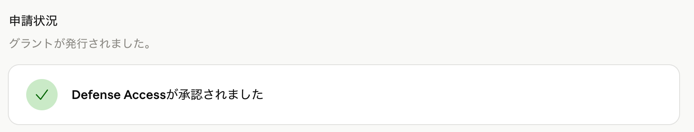
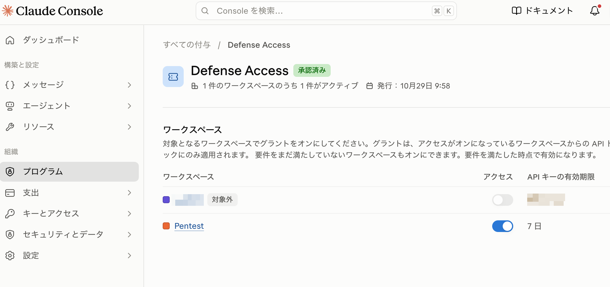
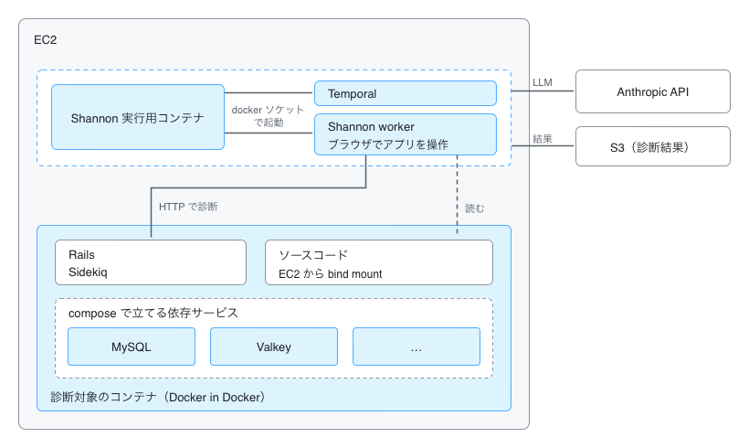

こんにちは、[フィッツプラス](https://zenn.dev/fitsplus_dev) の高山です。

最近、Claudeのプラン（MaxやTeamなど）に、APIのクレジットが毎月付いてくるようになりました。

https://support.claude.com/en/articles/17154008-monthly-api-credits-for-max-ultra-and-team-plans

ありがたい。ありがたいんですが、これがClaude Codeで使えるものではなく、Claude APIやAgent SDKなど、自分でAPIを呼ぶ用途向けのクレジットなんですよね。普段の開発はClaude Codeで回ってるし、APIを叩くプロダクトを今すぐ作る予定もないしで、使い道が結構、いや、かなり限定されていて、どうしようかなーと絶賛放置していました。繰り越しもできないので、放置してたらそのまま消えちゃうんですけどね…。

一方で、AIのペンテストツール「Shannon」のことは前から気になってたんですよね。

https://github.com/KeygraphHQ/shannon

改めて調べてみたら、ShannonはAnthropicのAPIで動かせるらしい。さらに、Shannonで脆弱性検査を毎週回そうというこちらの記事にも出会うわけです。

https://zenn.dev/kusuke/articles/4d1940e3a67f0f

**これはクレジットの使い道として、ちょうどいいんじゃなかろうか**、と。せっかくの機会なので、重い腰を上げてやってみることにしました。

とはいえ、一番気になったのは「で、うちのアプリだと1回いくらかかるの？」というところです。公式の目安はあるものの、うちのサービスは割とデカいので、クレジットがあっという間に溶けたら悲しいじゃないですか。というわけで、実際に環境を作って回してみたので、事前に準備することや構成、時間と費用感をまとめました。

## Shannonとモデル

Shannonは、ソースコードと動いているアプリ、テスト用のアカウントを渡すと、偵察→脆弱性の分析→実際に攻撃して検証→レポート、までを自動でやってくれるホワイトボックス型の診断ツールです。OSS版はローカル（Docker）で動きます。

使えるモデルはいろいろあって、AnthropicのAPI、OpenAI、AWS Bedrock経由のモデルなどが選べます。今回はクレジットを使いたいので、AnthropicのAPIを使います。モデルはClaude Sonnet 5です。

## 事前準備：Cyber Verification Programに申し込む

ここが一番大事なところです。

Anthropicのモデルには、サイバー攻撃っぽい作業を止める安全装置がかかっています。ペンテストはまさに「攻撃」なので、何も準備せずにShannonを動かすと、モデルの確認の段階でこんな感じに弾かれます。

```text
▲  Model validation failed

  Pipeline failed

  Anthropic declined the security workload behind its cyber-access program.
  Hint: Your Anthropic organization must complete cyber verification. See https://support.claude.com/en/articles/14604842-real-time-cyber-safeguards-on-claude-opus-and-sonnet, then retry. Or use the claude-sonnet-4-6 model instead.

  Reference code: AnthropicCyberAccessError
```

これを緩めるのが **Cyber Verification Program（CVP）** です。セキュリティの用途で使うことを認めてもらうための申請で、Verification Portal（`portal.anthropic.com`）から申し込めます。

https://support.claude.com/en/articles/14604842-real-time-cyber-safeguards-on-claude-opus-and-sonnet

ペンテストをやるなら、必ずやっておきましょう。

### claude.aiとClaude Consoleで申し込みが別

で、ここで私は見事にハマりました。

CVPのDefense Access（3段階のうち、いちばん基本的なもの）は、実はclaude.aiのほうで先に申し込んで承認をもらっていたんです。なので「よし、もう準備できてるな」と思ってShannonを回したら、上のエラーで止まる。

調べてみると、**claude.aiとClaude Console（API）は別の組織になっていて、CVPの申し込みも組織ごとに別**なんですよね。ぐぬぬ。Shannonで使うのはAPIなので、Consoleの組織として改めて申し込む必要がありました。



私の場合は、申し込んだその日のうちに、すぐDefense Accessの承認をもらえました。なんとなく自動で処理されてる雰囲気は感じましたが、たまたまラッキーだっただけかもしれません。審査には時間がかかることもあるようなので、診断の予定があるなら余裕を持って申し込んでおくのがいいと思います。

### 承認されたら、ワークスペースに割り当てる

もうひとつハマりポイントがあって、Consoleの組織では**承認されただけでは有効にならない**んです。プログラムを使うワークスペースを、個別に割り当てる必要があります。

1. Claude Console（`platform.claude.com`）にAdminかOwnerでサインインする
2. 組織 ＞ プログラム を開き、承認されたグラント（私の場合は Defense Access）を選ぶ
3. ワークスペースの表で、診断に使うワークスペースのアクセスをオンにする



ここまでやっておけば、Shannonを実行したときに、最初のモデルの確認で `Cyber access verification — OK` と出るようになります。この表示が出たときはちょっと興奮しました。

### ワークスペースとAPIキーの準備

CVPと合わせて、以下もやっておくと安心です。

- **診断専用のワークスペースを作り、使用額の上限を設定する**：Shannonには時間や費用の上限設定がないので、ここが最後の歯止めになります
- **そのワークスペースでAPIキーを発行する**：CVPの要件で、キーの有効期間は**最長7日**です

7日はわりと短いので、定期実行にする場合も、診断の前にキーを発行し直して入れ替える運用になりそうです。

ちなみにAnthropic APIには、キーを置かずに短期の認証情報で呼べる「ワークロードIDフェデレーション」という仕組みもあります。いろいろ試しつつ並行して調べた感じでは、Shannonではまだ使えなさそうでした。対応を求める声はissueに上がってますね。

https://github.com/KeygraphHQ/shannon/issues/496#issuecomment-6505711954

で、困ったことに、CVPの要件では**2026年12月15日以降、APIキーそのものが使えなくなる**予定なんですよね。

https://support.claude.com/en/articles/17202708

それまでにShannon側で対応されないと、APIキーで動かしている今のやり方は使えなくなりそうです。今後の動きを見守りたいところ…。

## 私が構築した検査環境

さて、ここからは環境の話です。

方針として決めていたのは、次のあたりです。

- いずれは定期的に自動で回したいので、手元のMacではなくAWS上で動かす
- 普段使っている開発環境を汚したくない。攻撃されて壊されても困る
- 本番・staging・QAの環境には一切リクエストを送らない

で、**開発で使っているローカル環境を、EC2の中にまるっと立ち上げて、そこを検査する**ことにしました。普段の開発環境をそのままDockerに閉じ込めて検査できるようにしておけば、ほかのサービスにも持っていきやすくて、なんか汎用性高そうじゃね？と。本当にそうかはまだわかんないですけど。

あと、毎回まっさらな状態で検査したいという気持ちもありました。特にDBですね。攻撃の検証でデータが書き換わったりもするので、前回の診断の残骸が残ったDBのまま次の診断が走る、みたいな状態は避けたいなと。毎回ソースから環境を作り直して、DBもseedのダミーデータから入れ直せば、そこを気にしなくて済むんじゃないかなと。

### 構成



ざっくりこんな感じです。

- 診断のときだけEC2を起動する（`m7g.xlarge`、4 vCPU / 16 GB）。EC2の中でRailsやMySQL、Shannonのworker（ブラウザ込み）までいろいろ立ち上げるので、メモリは結構必要なんですよね。接続はSession Managerで、インバウンドは全部閉じてます
- **診断対象は1つのコンテナに閉じ込める**。Rails・Sidekiqはこのコンテナで動かし、MySQLなどの依存サービスは中でdockerdを動かして（Docker in Docker）、開発用のcomposeで立ち上げる。DBにはseedのダミーデータを入れる
- **Shannonは、診断対象のコンテナの外にある別のコンテナから動かす**。APIキーと診断結果を、診断対象から届かない場所に置くため
- EC2のメタデータ（IMDS）のホップ制限を1にして、診断対象のコンテナからインスタンスロールの権限を取れないようにする
- 結果（レポート一式）はS3に置く。EC2を終了すると中身が消えるので

本当はDBを別にしたり、外向きの通信を絞ったりしたほうがもっといいんだろうなーとは思ってます。ただ今回は、**とにかく環境ごと閉じ込めて、使い捨てで実行できること**を優先しました。

### 実行

EC2に入ったら、tmuxの中で診断を流します。Session Managerは無操作20分で切れて処理も止まるので、tmuxは必須です。

Shannonには、本番の診断の前に「モデルを呼べるか（CVPの確認もここ）」と「テスト用アカウントでログインできるか」だけを確かめるモードがあります。いきなり本番の診断を流すと、どこかで詰まったときにお金と時間が溶けるので、このほとんど費用のかからない確認から順番に進めるのがおすすめです。モデルの確認は約1分・$0、ログインの確認は数分・$0.1未満でした。

終わったらSlackに、所要時間と費用、深刻度ごとの件数、S3のレポートへのリンクが飛ぶようにしてます。MTG中に終わってても気付けるのでわりと便利。


### Sonnet 5.5は動かなかった

ちなみに、最初はSonnet 5.5で本番の診断を流したんですが、事前調査の最後で同じエラーで止まりました。

```text
Invalid signature in thinking block ... The `tools` list differs from the one this block was created with.
```

Sonnet 5.5は、モデルの思考の記録（thinking block）を、それが作られたときの会話とツールの一覧に結び付けているらしく、Shannonは事前調査の終わりのほうでツールの一覧を変えるので、そこで400が返ってくるみたいです。一時的なエラーかなと思ってもう1回流してみたんですが、2回とも同じところで落ちました。Shannon 3.5.0でも直ってませんでした。

この2回で、1回あたり約26分・$14が溶けました。痛い出費ですが、まあ授業料ということで…。Sonnet 5はこの制約の対象外なので、問題なく完走します。

## 結果としての時間と費用

お待ちかねの実績です。対象はRailsのメインのアプリ（API・管理画面込み）と、Nuxtで作られた別のサービスの2つで、どちらもSonnet 5・Shannon 3.5.0で回しています。

| 対象 | 所要時間 | 費用 |
| --- | --- | --- |
| Railsのメインのアプリ | 約1時間56分 | 約$109 |
| Nuxtのサービス | 約1時間1分 | 約$39 |

Railsのほうの内訳は、事前調査と偵察で約$21、脆弱性の分析で約$31、攻撃の検証で約$56、レポートで約$1でした。**実際に攻撃して確かめる段階が、全体の半分くらい**を占めてますね。

公式の目安は「Sonnetで1回約$50、1〜1.5時間」なので、うちのRailsアプリは時間も費用も目安を超えて、費用は倍くらいかかった感じです。アプリの規模でそれなりに変わるので、まずは1回回してみて、自分のアプリでの目安を掴むのが良さそうです。

ほかに、わかったこともいくつか。

- **Shannonが表示する費用とConsoleの使用額は、ほぼぴったり合う**。最初はConsoleの使用額をちょいちょい覗いて見比べてたんですが、毎回ほぼ同じだったので、Shannonの表示を見ていれば十分そうです
- **EC2の費用は誤差**。`m7g.xlarge` は1時間$0.2108なので、2〜3時間回しても1ドル未満です。ただ、起動しっぱなしにすると月$150ちょっとかかるので、終わったら停止か終了を忘れずに
- **結果は回すたびに結構変わる**。何回か回してみたら、前回だけ・今回だけ見つかった指摘がそれなりにありました。なので、1回で全部拾おうとするより、回数を重ねて拾っていく考え方がいいのかなと思ってます

1回あたりの目安がわかったので、クレジットの範囲でどのくらいの頻度で回せるかも見えてきました。毎週は厳しいけど、月に2〜3回ならいけそう。思ったより現実的な数字で、ちょっとホッとしました。

あとは、実際に直す工数は取れるのかって話かなと思います。うちでは前々から、プロダクトで使ってるnpmパッケージの脆弱性のサマリやコンテナイメージのスキャン結果などを見ては対応していくという取り組みをしています。最近はさらに、持ち回りでセキュリティ対策を優先して対応する体制も作りました。Shannonの指摘もここで対応していく予定です。この辺の仕組みは改めて紹介できたらと思います。

## まとめ

- Anthropicのクレジットで回すならAPIが必要で、**CVPはConsoleの組織で申し込む**（claude.aiとは別！）。承認されたらワークスペースへの割り当ても忘れずに
- 開発用のローカル環境をEC2の中にまるっと閉じ込めたら、既存の環境を気にせず、使い捨てで回せるようになった
- 費用は、Railsのメインのアプリで1回約$110・2時間くらい、Nuxtのサービスで$40前後・1時間くらい。Sonnet 5.5は今のところShannonでは動かないので、Sonnet 5で回すのがいいと思います

正直、使い道に困ってたクレジットが、ちゃんとプロダクトの安全性に還元される形になったのは嬉しいです。いやしかし、AIが自分たちのアプリに本気で攻撃を仕掛けてレポートを書いてくれる時代なんですね。もうペンテストは定期的な健康診断みたいなもんでいいんじゃね？って感じに…。

同じようにクレジットの使い道に迷ってる方や、Shannonを試してみたい方の参考になれば幸いです。

おしまい。
